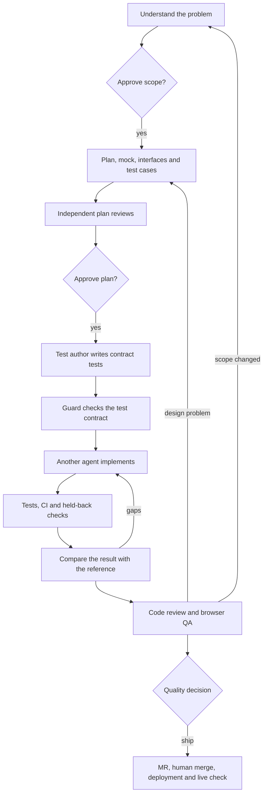

# Marc Baumholz's AI Coding Setup

I use Claude Code and Codex to work on products such as CoachBot. This repository explains the skills, project instructions and tools I have put together, and how I use them to plan, build and check changes.

For a small fix, I read the relevant code, make a small change and check it. For work with more risk, I have a longer workflow called `software-factory`. It separates planning, test writing, implementation and review, with decisions left to me at specific points.

**Snapshot: 12 October 2026.** The documentation comes from local files, installation metadata and a sample of session logs. Some parts describe the intended process; others have direct usage or test evidence. [Sources and limitations](docs/evidence.md).

## My usual approach

1. Define the problem, expected behaviour and acceptance criteria.
2. Read the relevant project instructions, code, callers and tests.
3. Decide how much planning and review the change needs.
4. Question assumptions before committing to a design.
5. Make a small change, reusing what the project already has.
6. Run suitable checks and review the diff.
7. Record recurring mistakes and improve the instructions or checks.

I use skills to make these steps easier to repeat. The useful part is knowing which instructions apply to the task and checking the result.

## The software factory

The CoachBot factory is a local skill with eight phases. A test author writes the acceptance tests, a different agent implements the change, and a script checks that the implementer has left those tests intact. Other roles review the plan and check the running app.

I approve the scope, plan and quality decision. Merging remains a separate human decision.

The [factory guide](docs/software-factory.md) explains the roles, scripts and stopping rules. Version 2 was edited on the day of this snapshot; a completed run of that version has not been verified.

## What makes up the setup

| Part | Purpose | Examples |
| --- | --- | --- |
| Coding tools | Work with agents, code, browsers and documents | Claude Code, Codex Desktop/CLI |
| Project instructions | Explain the codebase and working rules | `CLAUDE.md`, `AGENTS.md`, area rules, ADRs |
| Skills | Instructions for a particular kind of task | `software-factory`, `ponytail`, `verification-loop` |
| Agent roles | Give separate tasks and review perspectives | Test author, implementer, reviewer, verifier |
| Checks | Test concrete properties of a change | Compiler, tests, CI, browser, guard scripts |
| Working notes | Record mistakes and repeated work | Mistakes index, skill observations, review notes |

A skill is an instruction file. An agent carries out a task. A CLI or MCP server provides tools. Having a skill installed says little about whether I use it or whether its tools work in the current environment.

## Where the skills come from

The collection includes project-specific instructions, adapted open-source skills, plugins and local skills based on technical books.

| Source | Examples |
| --- | --- |
| Local CoachBot workspace | `software-factory`, `full-review`, `second-opinion` |
| [DietrichGebert/ponytail](https://github.com/DietrichGebert/ponytail) | Small changes, reuse and avoiding unnecessary code; local variants exist |
| [mattpocock/skills](https://github.com/mattpocock/skills) | Planning questions, domain modelling, bug diagnosis and handoffs |
| Technical books | Local architecture, debugging and refactoring skills |
| Platform bundles | System and plugin skills supplied through Codex |

[Skill sources](docs/skills-and-sources.md) lists the known origins, local changes and gaps for the selected skills.

## Skill files

The [skills directory](skills/README.md) includes a core selection of 14 skills in 15 folders, covering planning, implementation, verification, review, QA, architecture, debugging and refactoring. Ponytail has separate Claude and Codex variants. References, templates and scripts are included where needed. Private design-system files are excluded.

Start with [develop-things](skills/codex/develop-things/SKILL.md) for a short coding process or [software-factory](skills/coachbot/software-factory/SKILL.md) for the longer workflow. The export notes explain dependencies and publication edits. Private project state, incident history and customer personas stay out of the export.

## What was checked

- The exported folders include their source hashes, publication edits and dependencies in the manifest.
- A sample of 40 CoachBot session files contained 30 explicit skill calls, including `full-review`, `coachbot-design` and `verification-loop`. It does not cover all my work.
- The existing factory scripts passed 18 guard self-tests and 9 reference-comparison self-tests.
- Some skill origins remain unknown. The factory also has conflicting commit instructions, documented in the guide.
- The project name “MyAgent” has not been matched to a local repository. Its section describes how I would apply the approach to another project.

## Further reading

- [Tools and file locations](docs/setup.md)
- [Working through a change](docs/workflow.md)
- [Factory phases and roles](docs/software-factory.md)
- [Skills and sources](docs/skills-and-sources.md)
- [Evidence and open issues](docs/evidence.md)
- [Example project instructions](examples/AGENTS.md)
- [Task brief template](examples/task-brief.md)

The repository contains documentation, selected skill copies and generic examples. Private application files and session transcripts stay local.
